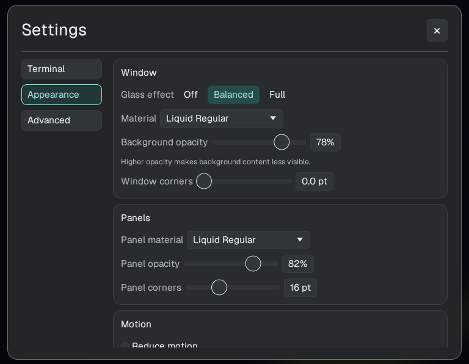

<p align="center">
  
</p>

<h1 align="center">Plyra Terminal</h1>

<p align="center">
  A GPU-rendered terminal with native shell sessions, a configurable glass workspace, and system tools.
</p>

<p align="center">
  <a href="https://github.com/J-x-Z/plyra-terminal/releases">Releases</a> ·
  <a href="docs/RELEASE_VERIFICATION.md">Verify a release</a> ·
  <a href="docs/ARCHITECTURE.md">Architecture</a> ·
  <a href="apps/android/README.md">Android build guide</a> ·
  <a href="LICENSE">License</a>
</p>

This GitHub release is a **source beta**. Platform installers are pending verification of corresponding source and licenses.

<p align="center">
  
  <br>
  <sub>Appearance settings on CachyOS with Niri (Wayland).</sub>
</p>

## What you can do

- **Work in tabs and splits.** Run local shells in PTY sessions, search scrollback, select and copy output, and use Unicode and your platform input method.
- **Tune the workspace.** Set fonts, colors, background opacity, panel appearance, and shortcuts. Background blur follows the capabilities of the operating system and compositor.
- **Choose your shell.** Use the system default or configure an executable with its own arguments and environment. Builds that include Aether Shell support it as a selectable profile.
- **Use system and remote tools.** Open SSH sessions, inspect supported system data, save diagnostics, and connect to configured MCP servers over stdio or Streamable HTTP. Calling an MCP tool or requesting administrator access takes an explicit action.

## Beta platforms

| Platform | Target | Verification |
| --- | --- | --- |
| macOS | Apple Silicon (`arm64`) | Native desktop, shell switching, and administrator authorization tested. |
| Linux | `x86_64` | Native desktop and redesigned Settings tested on CachyOS with Niri/Wayland. Earlier builds also exercised X11. |
| Windows | Windows 11 x64 | Native core tested with ConPTY and GPU rendering. The redesigned Settings build has been cross-compiled for x64 and awaits a native GUI test. |
| Android | `arm64`, API 26+ build target | Settings, the bundled Arch environment, and Aether Shell tested on Galaxy Z Fold6 under the ordinary Android app account. |

Development builds use ad-hoc signing on macOS and debug signing on Android. Windows developer packages are unsigned.

## Get started

For a desktop source build, use Rust, Cargo, and the native build tools for your platform.

```sh
git clone https://github.com/J-x-Z/plyra-terminal.git
cd plyra-terminal
cargo run --locked -p glass-terminal-desktop
```

| Platform | Open Settings | Build and packaging |
| --- | --- | --- |
| macOS | `⌘,` | [Apple Silicon app bundler](tools/build_macos_app.py) |
| Linux | `Ctrl+,` | [Linux build and installation guide](packaging/linux/README.md) |
| Windows | `Ctrl+,` | [Windows packager](tools/package_windows_app.py) |
| Android | Long-press the terminal and choose **Settings** in **Commands** | [Android APK and bundled shell guide](apps/android/README.md) |

## Android shell profiles

The ARM64 package can include an Arch Linux ARM environment. It expands offline into app-private storage on first launch and starts Bash with glibc. Use **Settings → Terminal → New sessions** to switch to Android Shell or Aether Shell when available.

From an Arch session with the bundled tools, run `aether-shell` to start Aether Shell, `glass-android battery` for battery status, or `glass-android settings` to open Settings. Everyday terminal and Arch use requires ordinary app permissions. Host administrator actions depend on a supported root manager and explicit authorization.

## Source and license

The Rust workspace shares terminal state, GPU rendering, PTY sessions, and system integration. [Desktop entry point](apps/desktop) · [Android entry point](apps/android) · [Security model](docs/SECURITY.md)

Plyra Terminal uses GPL-3.0-only. Third-party components retain their own licenses. [License](LICENSE) · [Dependency notices](docs/DEPENDENCY_LICENSES.md)
